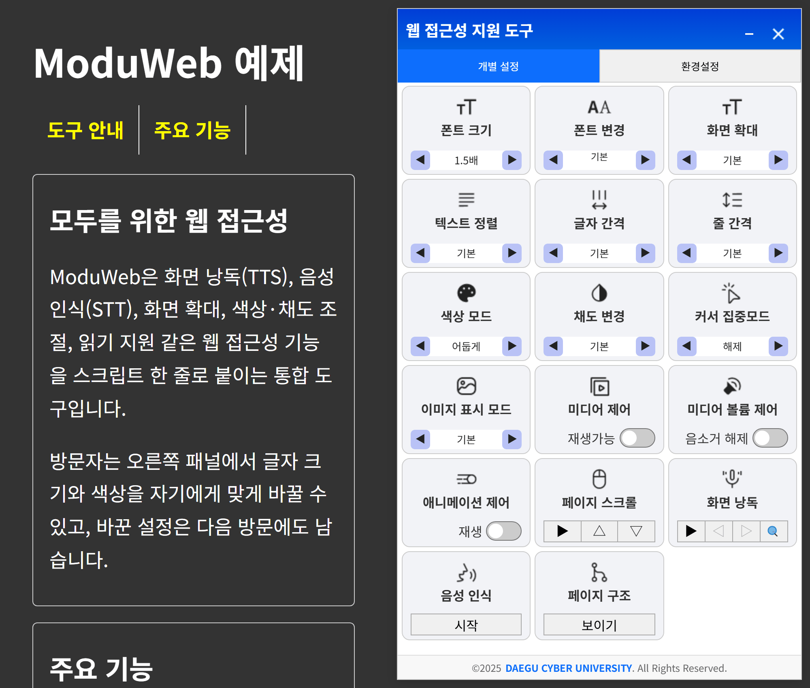
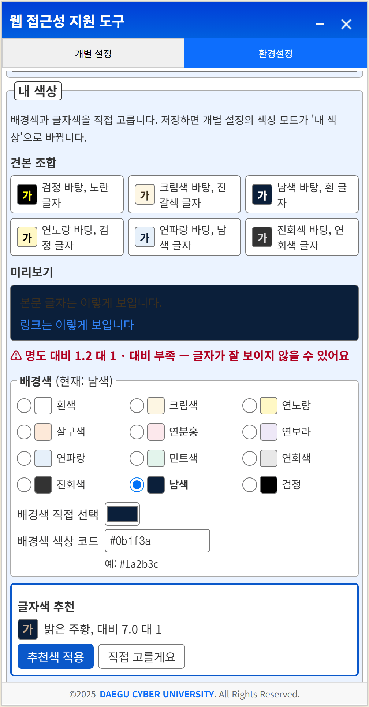
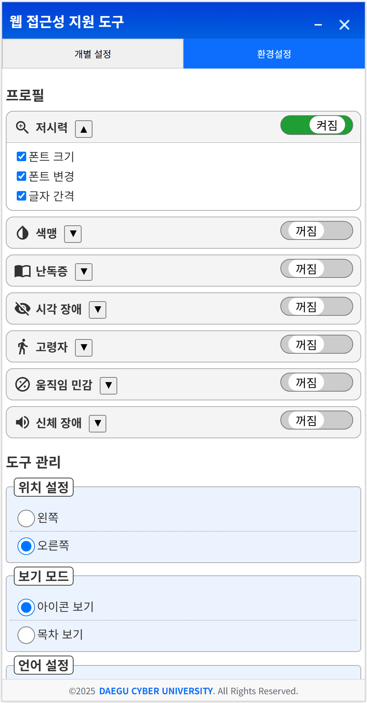

# ModuWeb (Web Accessibility Tools)

[](LICENSE)
[](https://github.com/Daegu-Cyber-University/ModuWeb/releases)
[](https://github.com/Daegu-Cyber-University/ModuWeb/actions/workflows/ci.yml)
[](https://www.jsdelivr.com/package/gh/Daegu-Cyber-University/ModuWeb)

> A drop-in web accessibility widget for any website — add screen reading (TTS), voice commands (STT), magnification, color adjustment and more with a single script tag.
>
> 한국어 문서: **[README.md](README.md)**

**🔗 Live Demo: <https://daegu-cyber-university.github.io/ModuWeb/>**

[](https://daegu-cyber-university.github.io/ModuWeb/)

## Why ModuWeb?

- **One-line install** — a single `<script>` tag with `data-wat-auto`. No build step, no framework required.
- **Works offline / in air-gapped networks** — `webAccTools.standalone.min.js` inlines CSS, icons and Korean locale data into **one file**. No external network needed.
- **TTS & STT without API keys** — screen reading and voice commands run on the browser's Web Speech API. Nothing to sign up for, nothing to pay.
- **Built to WCAG 2.1 AA · KWCAG 2.1** — designed around both the international standard and the Korean government accessibility standard, making it a fit for Korean public-sector sites. The panel UI itself is audited against WCAG 2.2 AA (target size, contrast, focus management), and issues found are fixed and logged in the [CHANGELOG](CHANGELOG.md).
- **6 UI languages** — Korean, English (US/GB), Japanese, Chinese, German.
- **7 accessibility profiles** — one-click presets for low vision, color blindness, dyslexia, visual impairment, seniors, motion sensitivity and physical disability.
- **Custom colors** — visitors pick their own background and text colors; the panel shows the contrast ratio and suggests a 7:1 counterpart color (WCAG 1.4.8).

| Custom colors — suggests a 7:1 pair when contrast is low | 7 accessibility profiles |
|---|---|
|  |  |

<sub>The screenshots show the Korean UI; the panel also ships in English (US/GB), Japanese, Chinese and German.</sub>

## Quick Start

### Option 1 — CDN (simplest, auto-updating)

```html
<script src="https://cdn.jsdelivr.net/gh/Daegu-Cyber-University/ModuWeb@2/dist/webAccTools.standalone.min.js" data-wat-auto></script>
```

`@2` serves the latest 2.x release, so new releases reach your site without downloading anything. Use `@2.3` to receive patch releases only, or a tag such as `@v2.3.11` to pin a version. Don't use `@main`: it serves unreleased commits. A new release can take up to 7 days to reach every visitor (jsDelivr's version-range cache plus browser caches); purging the CDN cache with the [jsDelivr purge tool](https://www.jsdelivr.com/tools/purge) makes new visitors get it right away. jsDelivr also serves the other locales with an `Access-Control-Allow-Origin` header, so no server setup is needed.

Configure declaratively with `data-wat-*` attributes:

```html
<script src=".../webAccTools.standalone.min.js" data-wat-auto
	data-wat-language="en-US"
	data-wat-config='{"branding": {"copyrightUrl": "https://example.com"}}'></script>
```

| Attribute | Description |
|---|---|
| `data-wat-auto` | Enable auto-initialization (required switch) |
| `data-wat-config` | Path to config.json (relative to the script) or inline JSON (starts with `{`). With the CDN, a relative path resolves against jsDelivr, so use inline JSON or an absolute URL on your site |
| `data-wat-language` | Default language (`ko`, `en-US`, `en-GB`, `ja`, `zh`, `de`) |
| `data-wat-container` | Container CSS selector |
| `data-wat-inject-css` | Set `"false"` to manage the stylesheet with your own `<link>` |

### Option 2 — Single file (offline / air-gapped)

Copy **one file**, `dist/webAccTools.standalone.min.js`, to your server. CSS, icons and Korean locale data are bundled inside — no assets folder, no config file, no network access required.

```html
<script src="/path/to/webAccTools.standalone.min.js" data-wat-auto></script>
```

> For languages other than Korean, also deploy the `assets/locales/` folder (Korean is built in).

### Option 3 — Self-hosted folder

1. Download the zip from the [releases page](https://github.com/Daegu-Cyber-University/ModuWeb/releases)
2. Copy the `dist/` folder to your web server **as-is** (the JS resolves CSS/icons/locales under `assets/` by relative path)
3. Add one line to your HTML

```html
<script src="/path/to/dist/webAccTools.js" data-wat-auto></script>
```

### Option 4 — Manual initialization

```html
<link rel="stylesheet" href="path/to/dist/assets/css/webAccTools.css">
<script src="path/to/dist/webAccTools.js"></script>
<script>
	document.addEventListener('DOMContentLoaded', () => {
		const wat = new WAT({ configPath: './config.json' });
		window.watPlugin = wat;
		wat.init();
	});
</script>
```

### Loading from another domain

If the files live on a different (sub)domain from the page, the script itself still runs, but the browser requires an `Access-Control-Allow-Origin` header on the files the widget fetches from that server. Without it, the standalone file still works in Korean but cannot load other locales; with `webAccTools.js` + `assets/` the Korean locale and the open-button icon are blocked too, leaving the panel blank. The widget files are public static assets, so allowing every origin is fine. jsDelivr (Option 1) already sends the header.

```apache
# Apache — .htaccess in the widget folder (needs mod_headers)
<IfModule mod_headers.c>
	Header set Access-Control-Allow-Origin "*"
</IfModule>
```

For IIS add the same header under `system.webServer/httpProtocol/customHeaders` in `web.config`; for Nginx use `add_header Access-Control-Allow-Origin "*";` in the widget folder's `location`.

## Features

| Category | Features |
|---|---|
| Visual | Font size / typeface, text alignment & spacing, full-page magnification, hiding images or showing their alt text |
| Color | Light / dark / inverted color modes, custom text & background colors with 7:1 contrast suggestions, saturation control, red/green color-blindness correction |
| Focus | Reading guide (mask / underline) and large cursor, media & animation control, auto page scroll |
| Audio | TTS screen reading (auto / focus / keyboard modes), STT voice commands |
| Extras | Dictionary lookup (shown only when a dictionary server endpoint is configured), page structure viewer |
| Keyboard | Full keyboard navigation, focus indicators, shortcuts |
| Profiles | 7 one-click presets per disability type, settings persistence, export/import |

## Documentation

Full documentation (configuration options, API reference, developer guide) currently lives in the Korean [README.md](README.md) and [ARCHITECTURE.md](ARCHITECTURE.md). The library UI itself supports 6 languages. Contributions translating the docs are very welcome — see [CONTRIBUTING.md](CONTRIBUTING.md).

## License

[Apache-2.0](LICENSE) © [Daegu Cyber University](https://www.dcu.ac.kr)
